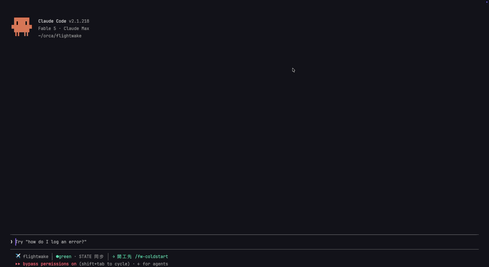

<!-- Primary edition (English). Translations: README.zh-TW.md (kept in sync) / README.zh-CN.md and README.ja.md (frozen at v0.17.0 since 2026-11-10, DECISIONS) — editing this edition obligates syncing zh-TW. -->
# flightwake ✈️

**Hand this repo to another person or another agent, and they can see how it was built: what was done, why each choice was made, and which traps were found.**

[](https://www.npmjs.com/package/flightwake) [](https://scorecard.dev/viewer/?uri=github.com/kaiwutech-TW/flightwake)

🌐 **English** · [繁體中文](README.zh-TW.md) · [简体中文](README.zh-CN.md) · [日本語](README.ja.md)

```bash
cd your-repo && npx flightwake setup
```



*A real cold start on this very repo (recorded live, zh-TW install): one command, two file reads, and a fresh session reports where the last one left off. Measured: about 25 seconds, two runs of `claude -p "/fw-coldstart"` on a fresh clone of this repo (Claude Code 2.1.321, 2026-11-10).*

flightwake keeps four plain Markdown files in your repo's `.flightwake/`: a short STATE (where things are, what's next), a
decision log (one line per choice, with the why), a list of known traps (each with how sure its root cause is), and a
flight record per stretch of work. The agent writes them as it works; Claude Code, Codex and Antigravity read them at
the start of every session. A known trap follows the files it is anchored to: when an agent in Claude Code or Codex edits
one of them or runs an anchored command, the trap shows up right after that call (a hook; it never blocks), and
Antigravity gets it as a rule it read *before* editing such a file in our tests. Everything is in git, so it travels with
the repo. **See what four months of it look like
in this repo: [docs/evidence.md](docs/evidence.md).**

[Illustrated website](https://flightwake.kaiwu.com.tw/en/) · [Website source](website/)

## Install

```bash
cd your-repo
npx flightwake setup                               # asks a few questions, lists every path it will write, installs after you confirm
npx flightwake init --agents=claude,codex,agy      # the same without questions (any of claude, codex, agy, gemini)
npx flightwake update                              # upgrade an existing install in place
```

Claude Code only, as a plugin (English skills): `/plugin install flightwake --marketplace kaiwutech-TW/flightwake`, then
`npx flightwake init --plugin` once per repo (or let `/fw-coldstart` offer it) — see [docs/install.md](docs/install.md#claude-code-plugin).

Zero runtime dependencies (Node ≥18 for the installer and the hooks). Verified on Claude Code, Codex and Antigravity;
Gemini CLI is kept for enterprise and API-key users. Languages, add-ons (the Claude Code mod, the status line, team
roles, Orca collaboration), `--private`, `doctor`, `uninstall`, migrating from GSD and a CI check:
**[docs/install.md](docs/install.md)**.

## How to use

### Right after the first install

1. Open an agent session in the repo and run `/fw-coldstart` — it notices STATE is still the unfilled template and writes the first STATE from the repo itself (health is never guessed green: it is yellow until something was actually verified)
2. `git add .flightwake .claude CLAUDE.md && git commit`
3. Every session after that follows the daily loop below

### The daily loop

You (and the model) only need to remember one thing: **start work with `/fw-coldstart`; the model triggers every other obligation itself** — the obligation table is already in the instruction file, and strong models both read it and honor it. A typical session:

```text
You:   /fw-coldstart
Model: (reads STATE + the latest record, about 25 seconds)
       "Last session got to X, health green, next entry point is Y.
        Unverified changes: none. Pick up from Y?"
You:   Yes, go
Model: (starts working directly. Makes a decision that closes off options →
        one line appended to DECISIONS; hits a non-obvious trap → /fw-trap)
You:   Wrap up
Model: (/fw-record: writes the flight record, updates STATE, runs the
        sensitive-info self-check)
```

Forgot to wrap up? When STATE lags ≥3 commits, the Stop hook blocks once before the session ends to remind you (it also nags when STATE claims health=green but the latest record carries no test evidence); `--ci` brings the same gate to other agents and human collaborators. Honest edges of the net: the lag counts *human* commits only — bot commits (`dependabot[bot]`, `renovate[bot]`, …) are excluded, because a dependency bump never makes STATE wrong and the bot's own PR could never satisfy the gate. A session that commits nothing (research, ops work) or a squash/rebase flow slips under it — the net catches forgetting; it doesn't replace the session-end obligation. For multi-session construction, say "handoff" before stopping so the model runs `/fw-handoff`.

### The only thing you need to watch

Whether STATE's health is honest (green/yellow/red). The framework has a single quality metric: **how long it takes a fresh session to reach a safe takeover after `/fw-coldstart`** — if that takes more than 5 minutes, your records are degrading. Everything else — record count, format compliance — doesn't matter.

When that light comes on, you don't do the maintenance yourself. Say: *"this cold start took X minutes — diagnose what's slow and compact."* The model comes back with a diagnosis (STATE too long? last session never wrapped up? stale TRAPS/DECISIONS entries?) and an item-by-item plan — which entries to mark superseded and why, which to merge — and you approve with one word. Facts work better than pressure: "over 5 minutes means the next session will fumble the takeover" is a prompt the model can reason about; "this is serious!" is not.

### See what it actually looks like

This repo dogfoods its own framework: [`.flightwake/`](.flightwake/) contains the real STATE, DECISIONS, and records — every step from the gap list to the open-source launch is recorded there. That's exactly what will grow in your repo after installing.

### Stage-by-stage playbook

New to working with a strong model? [docs/workflow.md](docs/workflow.md) is a stage map of what **you** do and what to say to the model at each point — beginner main line, advanced folds for Claude Code veterans. (繁體中文版:[workflow.zh-TW.md](docs/workflow.zh-TW.md))

Using more than one model on the same repo? [docs/multi-agent.md](docs/multi-agent.md) shows how Claude Code, Codex, Antigravity and Gemini CLI share one `.flightwake/` — what init installs for each, how to invoke the skills in each tool, and the wrap-up → commit → cold-start loop that makes the handover identical whichever model wrote last. (繁體中文版:[multi-agent.zh-TW.md](docs/multi-agent.zh-TW.md))

Running a team of agents (a project manager, a tech lead, a coder, a reviewer)? [docs/roles.md](docs/roles.md) covers `flightwake roles` (opt-in, v0.14.0+): the agent recommends a set of roles for your project, you preview and customize them, and each role is written into the instruction file its agent re-reads at every session start — so nobody forgets their job after `/clear`, across repos if your team spans several. (繁體中文:[roles.zh-TW.md](docs/roles.zh-TW.md) · 简体中文:[roles.zh-CN.md](docs/roles.zh-CN.md) · 日本語:[roles.ja.md](docs/roles.ja.md))

## Why this project exists

> **Records are the contrail your work naturally leaves behind — not a flight plan you must file before takeoff.**

A strong model doesn't need to be taught how to do the work — but there are four things no model can do however strong it gets, because they are **structural** and don't disappear as models improve:

1. **Sessions die; context is finite.** When work spans sessions, memory resets to zero; without records, every takeover is a git archaeology dig — a strong model just digs faster, it doesn't get to skip the dig.
2. **Git records the what, not the why.** Commits tell you what changed, never "why the other path wasn't taken" or "the root cause of that trap" — which happen to be the two most expensive pieces of information for the next session (or the next agent).
3. **Discipline drifts in long sessions.** "Reported done before the tests ran", "touched prod without leaving verification evidence" — these slides have nothing to do with model intelligence and need guards outside the model.
4. **Agents don't share state.** Claude, Codex, Antigravity and human teammates each see their own world; state only becomes everyone's once it's in git.

So flightwake supplements **persistence and discipline, not intelligence**. Its ancestor in spirit is GSD: GSD is **navigation** (turn-by-turn guidance for every step); flightwake is a **dashcam + warning lights + road signs** — strong models drive themselves, so the framework only does three things:

1. **Dashcam**: decisions, discoveries, verification evidence, recorded after the fact (`records/`, `DECISIONS.md`, `TRAPS.md`)
2. **Warning lights**: hard guards independent of model strength (tests green before "done", prod changes must leave verification evidence, destructive operations need confirmation first)
3. **Road signs**: any session can die; the next session reads `STATE.md` and takes over safely (about 25 seconds on this repo)

The origin was a real three-day session (2026-07-15~17: two repos, 19 commits, 4 cron jobs, 2 deep bug fixes — no upfront planning, zero derailment). It proved a strong model needs no navigation — but everything it left behind to make the next session possible (SUMMARY/CONTEXT/memory files) was improvised on the spot. flightwake turns that improvisation into an installable convention.

## Core principle: records follow work — they don't lead it

GSD is **stage-driven** (research→plan→execute→verify gates); flightwake is **trigger-driven** (events create obligations):

| Trigger event | Obligation | Tool |
|---|---|---|
| Starting to touch a repo | Read STATE + the latest record first | `/fw-coldstart` |
| Making a decision that closes off other options | One line into DECISIONS (append-only, with the why) | write directly |
| Hitting a non-obvious trap | One entry into TRAPS | `/fw-trap` |
| Touching schema / touching prod / ~3+ commits | Wrap up with a record | `/fw-record` |
| Work will span sessions | Write handoff/CONTEXT **before stopping** (not before starting) | `/fw-handoff` |
| Session about to close | Update STATE's position and next-step entry point | part of `/fw-record` |

**Escalation rule (the opposite of GSD)**: by default everything is quick — just start working; only "construction spanning multiple sessions" escalates to a phase (one CONTEXT file; plan decomposition is left to the model's in-the-moment judgment).

## File layout (after installing into a target repo)

```
your-repo/
├── .flightwake/
│   ├── STATE.md             # where we are now, next-step entry (always short, always current)
│   ├── DECISIONS.md         # append-only decision log (one line per decision, with the why)
│   ├── TRAPS.md             # trap registry (OKF-style frontmatter entries)
│   ├── TEMPLATE-record.md   # flight-record template
│   ├── hooks/state-check.mjs  # Stop hook: reminds you to wrap up when STATE lags ≥3 commits
│   ├── hooks/trap-check.mjs   # PreToolUse hook (Claude Code, Codex): shows a TRAPS entry anchored to what a call touches
│   ├── hooks/traps-core.mjs   # the TRAPS parser and matcher trap-check.mjs uses (same code as the CLI and the mod)
│   └── records/             # flight records (one per meaningful wrap-up)
├── .claude/skills/fw-*/     # the four skills (Claude Code)
├── .claude/settings.json    # init merges the Stop hook config here
├── .agents/skills/fw-*/     # the same four skills for Codex / Antigravity / Gemini CLI (when one of them is set up)
├── .codex/hooks.json        # Codex Stop hook (only when AGENTS.md is detected)
├── .agents/hooks.json       # Antigravity Stop hook (only with --agents=…,agy)
└── .gemini/settings.json    # Gemini CLI AfterAgent hook (only when GEMINI.md is detected)
```

The skills and hooks are convenience sugar per platform — the same four skills and the same check script, installed where Claude Code, Codex, Antigravity and Gemini CLI each look for them; `.flightwake/` itself is plain Markdown in git, so every agent (and every human) reads and writes the same state. Any other agent that reads the instruction file can follow the same trigger obligations by hand. Coexists with an existing GSD `.planning/` (old records become historical archives).

## Boundaries with neighboring systems

**Claude Code memory**: persistent memory has the same shape as flightwake (frontmatter + `[[links]]`) but lives on a different layer — memory is single-machine, single-person; flightwake's files go into git and travel with the repo to teammates, CI, and any agent. Repo facts (traps, decisions, state) go to flightwake; personal preferences and cross-project habits go to memory. Never write the same fact in both places — with one deliberate exception: a trap that isn't repo-specific (platform/language layer) lives in both, because the repo's registry must stay self-contained while your other repos need the warning too (one copy per scope is division of labor, not duplication).

**[Google OKF](https://github.com/GoogleCloudPlatform/knowledge-catalog/tree/main/okf)**: OKF manages the **knowledge layer** (system facts: schemas, metric definitions, code mappings); flightwake manages the **process layer** (what happened, why, where we are now). flightwake's knowledge-shaped artifacts adopt OKF conventions (YAML frontmatter + `[[links]]`) — naturally compatible on the shared "plain Markdown + frontmatter" substrate.

## Security

- **Zero dependencies, no network, no install scripts**: the installer only copies files; the hook only uses `git` (no shell) for read-only queries.
- **Fixed write scope**: `init` only touches `.flightwake/`, `.claude/skills/fw-*`, `.claude/settings.json`, the marker blocks inside agent instruction files (including the Orca block, only when you opted in), `~/.flightwake/registry.json` (init/update write it; uninstall removes this repo's entry), `.claude/skills/fw-roles` / `.agents/skills/fw-roles` (only when you opted into roles), `.claude/skills/flightwake-mod/` (only when you opted into the mod; `uninstall` removes the shipped files and keeps anything you added there, and with `--private` it is added to the exclude block), and — when Codex / Antigravity / Gemini CLI is set up — `.agents/skills/fw-*`, `.codex/hooks.json`, `.agents/hooks.json`, `.gemini/settings.json`; with `--private` it instead touches `.claude/settings.local.json`, `CLAUDE.local.md`, and the marker block in `.git/info/exclude` (the Codex/Gemini files are written only while untracked, and excluded). `uninstall` reverses the same scope. Nothing is ever written through a symlink or outside the repo: the install is checked first, and if any required path would be refused it stops before writing anything and names the path (exit 1). Files are replaced via a temp file + rename, never overwritten in place; uninstall and the roles commands follow the same rules. `--private` refuses up front if privacy can't take effect (something it must exclude is already tracked, or `.git/info/exclude` can't be written). `doctor` writes nothing — when the mod is installed it also runs `claude --version` (read-only). The one exception to "only copies files" is `git init`: it runs only after you confirm it in `setup`'s final summary, or when you pass `--git-init`.
- **The hook lives in git**: `.flightwake/hooks/state-check.mjs` is a file in your repo — anyone who can commit can change it, same trust level as all repo-local config; Claude Code asks for confirmation when loading it, Codex records a trust hash per hook definition and re-asks whenever it changes, and Antigravity asks once whether you trust the folder.
- Vulnerability reports: see [SECURITY.md](SECURITY.md). Published to npm via Trusted Publishing (with provenance); verify with `npm audit signatures`.

## Status

🚧 v0.x — actively dogfooded; conventions may still evolve (append-only files carry a `superseded` lifecycle, and read-side tolerance keeps old installs working).

## License

[MIT](LICENSE)
