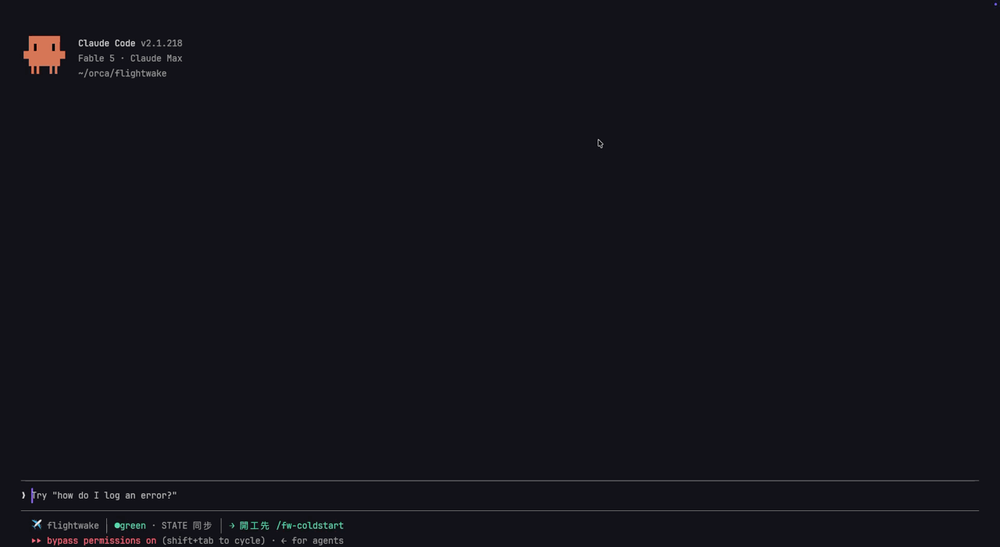

<!-- 繁體中文版。主版:README.md(英文);其他:README.zh-CN.md / README.ja.md(2026-11-10 起停在 v0.17.0,見 DECISIONS)— 改英文版或本版必同步另一版。 -->
# flightwake ✈️

**把 repo 交給另一個人或另一個 agent,對方就看得到它是怎麼做出來的:做了什麼、每個選擇為什麼這樣做、踩過哪些坑。**

[](https://www.npmjs.com/package/flightwake) [](https://scorecard.dev/viewer/?uri=github.com/kaiwutech-TW/flightwake)

🌐 [English](README.md) · **繁體中文** · [简体中文](README.zh-CN.md) · [日本語](README.ja.md)

```bash
cd your-repo && npx flightwake setup
```



*就在本 repo 實錄:一個指令、兩次讀檔,全新 session 準確回報上次做到哪、這次從哪接。實測約 25 秒:在本 repo 的乾淨 clone 跑兩次 `claude -p "/fw-coldstart"`(Claude Code 2.1.321,2026-11-10)。*

[](https://youtu.be/VKgTIfcjCEc)

*示範影片，55 秒([直式版](https://youtube.com/shorts/IwBm7B9Xam8))。*

flightwake 在 repo 的 `.flightwake/` 裡放四種純 Markdown 檔:一份簡短的 STATE(現在在哪、下一步)、一份決策日誌
(每個選擇一行,附原因)、一份已知的坑(每條標明根因有多確定),以及每段工作一份飛行紀錄。agent 邊做邊寫;
Claude Code、Codex、Antigravity 每個 session 開始時都會讀。坑會跟著它錨定的檔案走:Claude Code 或 Codex 的 agent
改到這些檔、或執行錨定的指令,那條坑會在這次呼叫之後馬上出現(hook,從不擋);Antigravity 則是收到一條規則,在我們的
實測裡它在改這類檔案**之前**就先讀了。全部在 git 裡,跟著 repo 走。
**看這個 repo 自己用了四個月的樣子:[docs/evidence.zh-TW.md](docs/evidence.zh-TW.md)。**

[圖解展示網站](https://flightwake.kaiwu.com.tw/zh-TW/) · [網站原始碼](website/)

## 安裝

```bash
cd your-repo
npx flightwake setup                               # 問幾個問題、列出將寫入的每個路徑,你確認後才安裝
npx flightwake init --lang=zh-TW --agents=claude,codex,agy   # 不問問題的版本(可任選 claude、codex、agy、gemini)
npx flightwake update                              # 就地升級既有安裝
```

只用 Claude Code 的話也可以裝成 plugin(skill 是英文):`/plugin install flightwake --marketplace kaiwutech-TW/flightwake`,每個 repo
再跑一次 `npx flightwake init --plugin`(或讓 `/fw-coldstart` 問你)——見 [docs/install.zh-TW.md](docs/install.zh-TW.md#claude-code-plugin)。

零執行期依賴(安裝器與 hook 需要 Node ≥18)。已在 Claude Code、Codex、Antigravity 真機驗證;Gemini CLI 保留給企業授權與
API key 用戶。語言、附加元件(Claude Code mod、底部儀表、團隊角色、Orca 協作)、`--private`、`doctor`、`uninstall`、
從 GSD 遷移與 CI 檢查:**[docs/install.zh-TW.md](docs/install.zh-TW.md)**。

## 使用教學

### 第一次安裝後

1. 在 repo 裡開一個 agent session,執行 `/fw-coldstart`——它會發現 STATE 還是未填的範本,並依 repo 現況寫出第一份 STATE(health 絕不亂猜成 green:沒有實際驗證前一律是 yellow)
2. `git add .flightwake .claude CLAUDE.md && git commit`
3. 之後每個 session 都是下面的日常循環

### 日常循環

你(和模型)只需要記得一件事:**開工先 `/fw-coldstart`,其餘義務模型自己會觸發**——義務表已貼在指令檔裡,強模型讀得懂也守得住。一個典型 session 長這樣:

```text
你:  /fw-coldstart
模型:(讀 STATE + 最近 record,約 25 秒)
      「上次做到 X,health green,下一步入口是 Y。有沒有未驗證的變更:無。從 Y 接手?」
你:  對,做吧
模型:(直接動手。過程中做了關掉其他選項的決策 → 自動一行進 DECISIONS;
      踩到非顯而易見的坑 → 自動 /fw-trap 登記)
你:  收尾
模型:(/fw-record:寫飛行紀錄、更新 STATE、敏感資訊自查)
```

忘了收尾也沒關係:STATE 落後 ≥3 commits 時,Stop hook 會在 session 結束前擋一次提醒(STATE 標 health=green 但最新 record 沒有測試證據時,也會提醒);CI 端用 `--ci` 把同一道關卡帶給其他 agent 與人類協作者。誠實標注這張網的邊界:落後量只數**人**的 commit——bot 的 commit(`dependabot[bot]`、`renovate[bot]` 等)不計入,因為依賴升版不會讓 STATE 變錯,而 bot 的 PR 也永遠無法自己補 STATE。零 commit 的 session(研究、ops 操作)或 squash/rebase 流程會從網下溜過;網接住的是「忘記」,不取代 session 結束時的義務。要跨 session 停手的大工程,停手前說「交接」讓模型跑 `/fw-handoff`。

### 你唯一要盯的事

STATE 的 health 誠不誠實(green/yellow/red)。框架的品質指標只有一個:**新 session 從 `/fw-coldstart` 到安全接手花了多久**——超過 5 分鐘,代表你的記錄在退化。其他一切——記錄多寡、格式合規——都不重要。

燈亮了也不用你動手保養,說一句:「**這次冷啟動花了 X 分鐘,診斷慢在哪並壓實**」。模型會帶著診斷(STATE 太長?上次沒收尾?TRAPS/DECISIONS 過時條目太多?)和逐條處置清單回來——哪條標 superseded、為什麼、哪些合併——你一個字放行即可。提示的訣竅是給事實不給情緒:「超過 5 分鐘代表下個 session 會接錯手」模型能推理;「這很嚴重!」它只能表演緊張。

### 想看實際長相

本 repo 自己就 dogfooding 這套框架:[`.flightwake/`](.flightwake/) 裡是真實的 STATE、DECISIONS 與 records——框架從缺口清單到開源上線的每一步都記錄在裡面,那就是裝進你 repo 後會自然長出的東西。

### 分階段實戰手冊

剛開始跟強模型協作?[docs/workflow.md](docs/workflow.md) 是一張階段地圖:每個階段**你**該做什麼、該對模型說什麼——主線給新手,「⚙ 進階」摺疊給 Claude Code 老手。

同一個 repo 用不只一個模型?[docs/multi-agent.zh-TW.md](docs/multi-agent.zh-TW.md) 說明 Claude Code、Codex、Antigravity、Gemini CLI 怎麼共用同一份 `.flightwake/`——init 替各家裝了什麼、各工具怎麼叫 skill、以及讓交接不分模型都一樣的「收尾 → commit → 冷啟動」循環。(英文版:[multi-agent.md](docs/multi-agent.md))

用一組 agent 組團隊(專案經理、技術總監、寫手、審核)?[docs/roles.zh-TW.md](docs/roles.zh-TW.md) 說明 `flightwake roles`(選配,v0.14.0 起):agent 依你的專案推薦一組角色,你預覽、客製,每個角色被寫進該 agent 每次開場都會重讀的指令檔——`/clear` 之後沒人忘記自己的工作,團隊橫跨多個 repo 也行。(英文版:[roles.md](docs/roles.md))

## 為什麼會有這個專案

> **記錄是工作飛過後自然留下的航跡,不是起飛前必須申報的飛行計畫。**

強模型不需要人教它怎麼做事——但有四件事再強的模型也做不到,而且全是**結構性**的,不會隨模型變強而消失:

1. **session 必死,context 有限**。工作跨 session 時記憶歸零;沒有記錄,每次接手都是一場 git 考古——強模型只是考古得比較快,不是不用考古。
2. **git 記 what,不記 why**。commit 查得到改了什麼,查不到「當時為什麼不選另一條路」和「這個坑的根因」——而這兩樣恰好是下個 session(或下個 agent)最貴的資訊。
3. **紀律會在長 session 裡漂移**。「測試還沒跑就回報完成」「動了 prod 沒留驗證證據」這類滑坡與模型智力無關,需要模型之外的硬防護。
4. **多 agent 不共享狀態**。Claude、Codex、Antigravity 與人類隊友各看各的;狀態進了 git 才是大家的。

所以 flightwake 補的是**持久性與紀律,不是智力**。前身思想來自 GSD:GSD 是**導航**(turn-by-turn 引導模型每一步),flightwake 是**行車記錄器 + 儀表警示燈 + 路標**——強模型自己會開車,框架只負責三件事:

1. **行車記錄器**:決策、發現、驗證證據,事後記錄(`records/`、`DECISIONS.md`、`TRAPS.md`)
2. **儀表警示燈**:模型強弱無關的硬防護(測試綠才算完成、prod 變更必留驗證證據、破壞性操作先確認)
3. **路標**:任何 session 死掉,下一個 session 讀 `STATE.md` 安全接手(本 repo 約 25 秒)

起源是一個真實的三日 session(2026-07-15~17:雙 repo、19 commits、4 條 cron、2 個深層 bug 修復,全程無事前計畫、零走偏)。它證明了強模型不需要導航——但它留下的 SUMMARY/CONTEXT/記憶檔,也就是讓下一個 session 能接手的東西,全是臨場發明的。flightwake 把那套臨場發明變成可安裝的慣例。

## 核心原則:記錄追隨工作,而非引導工作

GSD 是 **stage-driven**(research→plan→execute→verify 關卡制);flightwake 是 **trigger-driven**(事件觸發義務制):

| 觸發事件 | 義務 | 工具 |
|---|---|---|
| 開始動一個 repo | 先讀 STATE + 最近一筆 record | `/fw-coldstart` |
| 做出「關掉其他選項」的決策 | 一行進 DECISIONS(append-only,記 why) | 直接寫 |
| 踩到非顯而易見的坑 | 一則進 TRAPS | `/fw-trap` |
| 動 schema / 動 prod / 超過 ~3 commit | 收尾留 record | `/fw-record` |
| 工作會跨 session | **停手前**(非開工前)寫 handoff/CONTEXT | `/fw-handoff` |
| session 要關 | 更新 STATE 的位置與下一步入口 | `/fw-record` 內含 |

**升級規則(與 GSD 相反)**:預設一切都是 quick、直接動手;只有「跨多 session 的建設」才升級成 phase(一份 CONTEXT,plan 拆分交給模型臨場判斷)。

## 檔案結構(安裝進目標 repo 後)

```
your-repo/
├── .flightwake/
│   ├── STATE.md             # 現在在哪、下一步入口(永遠短、永遠新)
│   ├── DECISIONS.md         # append-only 決策日誌(一行一決策,記 why)
│   ├── TRAPS.md             # 坑 registry(OKF 式 frontmatter 條目)
│   ├── TEMPLATE-record.md   # 飛行紀錄模板
│   ├── hooks/state-check.mjs  # Stop hook:STATE 落後 ≥3 commits 時提醒收尾
│   ├── hooks/trap-check.mjs   # PreToolUse hook(Claude Code、Codex):呼叫碰到有錨點的坑時,把那條 TRAPS 提示出來
│   ├── hooks/traps-core.mjs   # trap-check.mjs 用的 TRAPS 解析與比對(和 CLI、mod 同一份)
│   └── records/             # 飛行紀錄(每次有意義的收尾一份)
├── .claude/skills/fw-*/     # 四個 skill(Claude Code)
├── .claude/settings.json    # init 併入 Stop hook 設定
├── .agents/skills/fw-*/     # 同一套四個 skill 給 Codex / Antigravity / Gemini CLI(設定了其中一家才裝)
├── .codex/hooks.json        # Codex 的 Stop hook(偵測到 AGENTS.md 才裝)
├── .agents/hooks.json       # Antigravity 的 Stop hook(用 --agents=…,agy 才裝)
└── .gemini/settings.json    # Gemini CLI 的 AfterAgent hook(偵測到 GEMINI.md 才裝)
```

skill 與 hook 是各平台的便利糖衣——同一套四個 skill、同一份檢查腳本,裝到 Claude Code、Codex、Antigravity、Gemini CLI 各自會去找的位置;`.flightwake/` 本體是進 git 的純 Markdown,所以每個 agent(和每個人)讀寫的是同一份狀態。其他 agent 讀指令檔也能手動遵循同一套觸發義務。與既有 GSD `.planning/` 可並存(舊紀錄即歷史檔案)。

## 與鄰近系統的分界

**Claude Code 記憶功能**:持久記憶與 flightwake 同形(frontmatter + `[[連結]]`)但不同層——記憶是單機單人的;flightwake 的檔案進 git,隨 repo 共享給團隊、CI 與任何 agent。分工規則:repo 的事實(坑、決策、狀態)進 flightwake;個人偏好與跨專案習慣進記憶。同一件事不要雙寫——唯一的刻意例外:**不是本 repo 特有的通用坑**(平台/語言層)兩邊都存,因為 repo 登記簿必須自足,而你的其他 repo 也需要這個警告(跨範疇各存是分工不是重複)。

**[Google OKF](https://github.com/GoogleCloudPlatform/knowledge-catalog/tree/main/okf)**:OKF 管**知識層**(系統事實:schema、指標口徑、代碼對照),flightwake 管**過程層**(發生了什麼、為什麼、現在在哪)。flightwake 的知識型產物採 OKF 慣例(YAML frontmatter + `[[連結]]`),兩邊在「純 Markdown + frontmatter」底層天然相容。

## 安全性

- **零依賴、無網路、無 install script**:安裝器只做檔案複製;hook 只用 `git`(無 shell)做唯讀查詢。
- **寫入範圍固定**:`init` 只碰 `.flightwake/`、`.claude/skills/fw-*`、`.claude/settings.json`、agent 指令檔裡的標記區塊(含 Orca 區塊,僅在你選用時)、`~/.flightwake/registry.json`(init/update 會寫;uninstall 移除本 repo 的條目)、`.claude/skills/fw-roles` / `.agents/skills/fw-roles`(僅在你選用 roles 時)、`.claude/skills/flightwake-mod/`(僅在你選用 mod 時;`uninstall` 只移除發行的檔、保留你自己加的;`--private` 時加進 exclude 區塊),以及(裝了 Codex / Antigravity / Gemini CLI 時)`.agents/skills/fw-*`、`.codex/hooks.json`、`.agents/hooks.json`、`.gemini/settings.json`;`--private` 時改碰 `.claude/settings.local.json`、`CLAUDE.local.md` 與 `.git/info/exclude` 裡的標記區塊(Codex/Gemini 那幾個檔只在未受追蹤時才寫,並加進 exclude)。`uninstall` 反向清除同一範圍。任何寫入都不經由 symlink、也不落在 repo 之外:安裝前先預檢,有必要路徑會被拒寫就在寫入任何東西之前中止並點名該路徑(以非零退出)。檔案一律以「暫存檔 + rename」取代,不原地覆寫;uninstall 與 roles 指令遵守同樣規則。`--private` 若隱私無法生效(要排除的東西已受追蹤,或 `.git/info/exclude` 寫不進去)會在一開始就拒絕。`doctor` 不寫入任何東西(裝了 mod 時,它會執行唯讀的 `claude --version`)。「只複製檔案」唯一的例外是 `git init`:只在你於 `setup` 最後摘要確認後,或你傳了 `--git-init` 時才會執行。
- **hook 進 git**:`.flightwake/hooks/state-check.mjs` 是 repo 內的檔案,能 commit 的人就能改——與所有 repo-local 設定同級。Claude Code 載入時會要求確認,Codex 依每個 hook 定義記一份信任雜湊、內容改了會再問,Antigravity 會問一次是否信任這個資料夾。
- 漏洞回報見 [SECURITY.md](SECURITY.md)。以 npm Trusted Publishing 發布(附 provenance),可用 `npm audit signatures` 驗證。

## 狀態

🚧 v0.x——持續 dogfooding 中;慣例仍可能演進(append-only 檔案有 `superseded` 生命週期,讀取端容忍讓舊安裝不受影響)。

## License

[MIT](LICENSE)
